<div align="center">

# Laporan Praktikum: Arsitektur Monolith vs Microservices dengan Flask Python


| | |
|---|---|
| **Nama** | Miftahul Qadri |
| **NIM** | 2024903430082 |
| **Mata Kuliah** | Paradigma Sistem untuk IT |
| **Topik** | Hands-on Arsitektur Monolith vs Microservices |
| **Bahasa / Framework** | Python 3 / Flask |
| **Lingkungan** | Windows, PowerShell, Virtual Environment (`venv`) |


### Program Studi Teknologi Rekayasa Komputer Jaringan
### Jurusan Teknologi Informasi dan Komputer
### Politeknik Negeri Lhokseumawe
### 2026


---


## Lembar Pengesahan


| No. Praktikum     | : | 01|
|------------------:|:-:|:--------------|
| Judul Praktikum   | : | Monolith vs Microservices |
| Tanggal Praktikum | : | 21-09-2026 |
| Tanggal Penyerahan| : | 28-09-2026 |
| Nama Praktikan    | : | Miftahul Qadri |
| NIM/Kelas Praktikan| : | 2024903430082 / TRKJ 3C |
| Nilai Praktikum   | : | .......................... |
| Dosen Pengampu    | : | Muhammad Reza Zulma, S.ST., M.Sc |

Mengetahui,  
Dosen Pengampu
<br><br><br><br><br>


Muhammad Reza Zulma, S.ST., M.Sc

NIP. 199205012022031005
</div>

##
## Daftar Isi

1. [Tujuan Pembelajaran](#1-tujuan-pembelajaran)
2. [Landasan Teori](#2-landasan-teori)
3. [Persiapan Lingkungan](#3-persiapan-lingkungan)
4. [Bagian 1: Membangun Aplikasi Monolith](#4-bagian-1-membangun-aplikasi-monolith)
5. [Bagian 2: Membangun Aplikasi Microservices](#5-bagian-2-membangun-aplikasi-microservices)
6. [Eksperimen Fault Isolation](#6-eksperimen-fault-isolation)
7. [Temuan Analisis: Stok Tidak Berkurang](#7-temuan-analisis-stok-tidak-berkurang)
8. [Perbandingan Monolith vs Microservices](#8-perbandingan-monolith-vs-microservices)
9. [Jawaban Bahan Diskusi](#9-jawaban-bahan-diskusi)
10. [Troubleshooting](#10-troubleshooting)
11. [Kesimpulan](#11-kesimpulan)
12. [Latihan Pengembangan](#12-latihan-pengembangan)

---

## 1. Tujuan Pembelajaran

1. Memahami konsep dasar aplikasi Monolith dan Microservices.
2. Mampu membangun backend sederhana menggunakan Flask Python.
3. Menganalisis kelebihan dan kekurangan masing-masing arsitektur melalui praktik langsung.

---

## 2. Landasan Teori

### 2.1 Monolith

Pada arsitektur **monolith**, seluruh fitur aplikasi (katalog buku, pesanan, pembayaran, dan seterusnya) disatukan dalam **satu codebase** dan berjalan di **satu proses/server**. Fitur-fitur saling berkomunikasi dengan cara memanggil fungsi atau mengakses variabel yang sama di memori.

Ciri-ciri:
- Satu codebase, satu proses, satu deployment.
- Komunikasi antar fitur berupa pemanggilan fungsi langsung (sangat cepat).
- Data biasanya dipakai bersama oleh seluruh fitur.
- Jika satu bagian crash, seluruh aplikasi bisa ikut mati.

### 2.2 Microservices

Pada arsitektur **microservices**, aplikasi dipecah menjadi **layanan-layanan kecil yang mandiri**. Setiap layanan punya tanggung jawab tunggal, kode sendiri, data sendiri, dan berjalan di proses/port sendiri. Antar layanan berkomunikasi lewat jaringan, umumnya **HTTP/REST API**.

Ciri-ciri:
- Banyak codebase dan proses, masing-masing bisa di-deploy sendiri.
- Komunikasi antar layanan lewat jaringan (ada latensi).
- Setiap layanan memiliki datanya sendiri.
- Kegagalan satu layanan tidak otomatis menjatuhkan layanan lain (*fault isolation*).
- Setiap layanan bisa di-*scale* secara terpisah (*independent scaling*).

### 2.3 Analogi

Bayangkan sebuah toko buku:

- **Monolith** seperti toko satu ruangan. Kasir, rak buku, dan gudang ada di satu tempat. Sederhana, tetapi jika listrik mati, semuanya berhenti.
- **Microservices** seperti toko yang dipecah menjadi unit terpisah. Bagian katalog dan bagian pemesanan punya ruangan sendiri dan berkomunikasi lewat telepon (HTTP).

### 2.4 Konsep Pendukung

| Istilah | Penjelasan |
|---|---|
| **REST API** | Gaya membuat API di atas HTTP dengan method seperti GET, POST, PUT, DELETE. |
| **Endpoint** | Alamat URL tertentu yang melayani permintaan, misalnya `/books`. |
| **JSON** | Format pertukaran data berbasis teks, misalnya `{"book_id": 1}`. |
| **In-memory database** | Data disimpan di variabel Python sehingga hilang saat server dimatikan. |
| **Fault isolation** | Kegagalan satu komponen tidak merambat ke komponen lain. |
| **Independent scaling** | Kemampuan memperbanyak server hanya untuk layanan yang bebannya tinggi. |
| **Latensi jaringan** | Waktu tunda akibat komunikasi antar layanan lewat jaringan. |

### 2.5 Kode Status HTTP yang Dipakai

| Kode | Arti | Dipakai saat |
|---|---|---|
| `200` | OK | Permintaan GET berhasil |
| `201` | Created | Pesanan berhasil dibuat |
| `400` | Bad Request | Buku tidak ada atau stok habis |
| `404` | Not Found | Buku tidak ditemukan di Book Service |
| `500` | Internal Server Error | Book Service tidak dapat dihubungi |

---

## 3. Persiapan Lingkungan

### Langkah 3.1: Buat folder proyek dan virtual environment

Virtual environment dipakai agar library proyek ini tidak bercampur dengan proyek lain.

```powershell
mkdir latihan-arsitektur
cd latihan-arsitektur
```
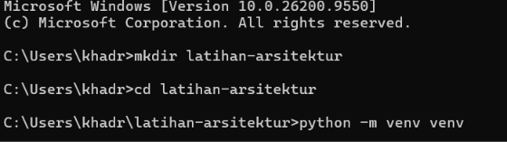
```
python -m venv venv
venv\Scripts\activate
```


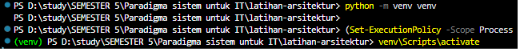


Jika berhasil, prompt terminal akan diawali `(venv)`.

> Jika PowerShell menolak menjalankan `activate` karena *execution policy*, jalankan:
> `Set-ExecutionPolicy -Scope CurrentUser RemoteSigned` lalu ulangi.

### Langkah 3.2: Instal library

```powershell
pip install Flask requests
```
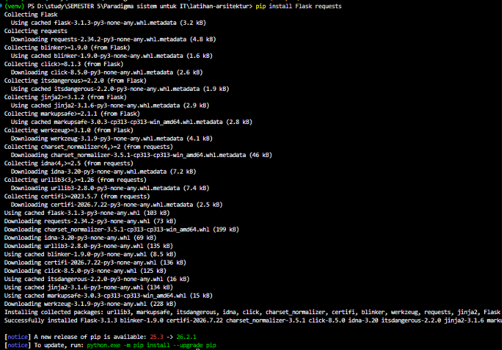


- **Flask**: framework web untuk membuat API.
- **requests**: library untuk mengirim HTTP request dari satu layanan ke layanan lain.

### Langkah 3.3: Verifikasi instalasi

```powershell
python -c "import flask, requests; print('OK')"
```

Jika muncul `OK`, lingkungan siap.

### Struktur folder akhir

```
latihan-arsitektur/
├── microservices
├──── book_service.py
├──── order_service.py
├── monolith
├──── monolith_app.py
└── venv/
```
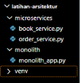


---

## 4. Bagian 1: Membangun Aplikasi Monolith

Seluruh rute dan logika bisnis (buku dan pesanan) digabung dalam satu file.

### Langkah 4.1: Buat file `monolith_app.py`

```python
from flask import Flask, jsonify, request

app = Flask(__name__)

# Database bohongan (in-memory)
books = [{"id": 1, "title": "Belajar Flask", "stock": 5}]
orders = []

# --- FITUR BUKU ---
@app.route('/books', methods=['GET'])
def get_books():
    return jsonify(books)

# --- FITUR PESANAN ---
@app.route('/orders', methods=['POST'])
def create_order():
    data = request.get_json()
    book_id = data.get('book_id')
    # Logika bisnis: cek stok buku langsung dari variabel global
    for b in books:
        if b['id'] == book_id and b['stock'] > 0:
            b['stock'] -= 1
            order = {"id": len(orders)+1, "book_id": book_id, "status": "berhasil"}
            orders.append(order)
            return jsonify(order), 201
    return jsonify({"error": "Buku tidak ditemukan atau stok habis"}), 400

if __name__ == '__main__':
    # Aplikasi berjalan di port 5000
    app.run(port=5000, debug=True)
```
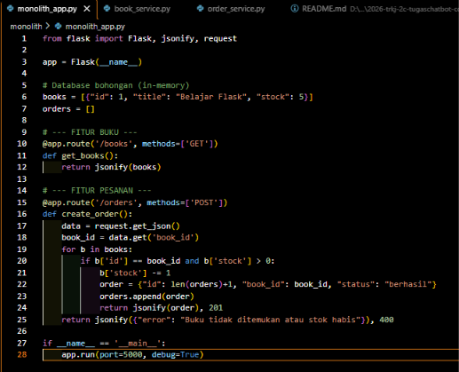


### Langkah 4.2: Penjelasan kode

| Bagian | Penjelasan |
|---|---|
| `Flask(__name__)` | Membuat objek aplikasi web. |
| `books`, `orders` | List Python sebagai database sementara. Data hilang saat server restart. |
| `@app.route('/books', methods=['GET'])` | Memetakan URL `/books` dengan method GET ke fungsi `get_books()`. |
| `jsonify(...)` | Mengubah data Python menjadi respons JSON. |
| `request.get_json()` | Membaca body JSON yang dikirim klien. |
| Loop `for b in books` | **Ciri monolith:** fitur pesanan langsung membaca dan mengubah variabel `books` milik fitur buku, tanpa komunikasi jaringan. |
| `return ..., 201` / `400` | Mengembalikan status HTTP sesuai hasil proses. |
| `app.run(port=5000, debug=True)` | Menjalankan server di port 5000 dengan mode debug (auto-reload). |

### Langkah 4.3: Jalankan aplikasi

Terminal 1:

```powershell
python monolith_app.py
```
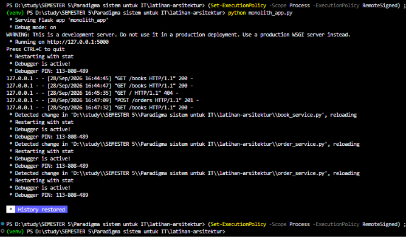


### Langkah 4.4: Uji coba API

Buka terminal baru (aktifkan `venv`). Karena memakai PowerShell, `curl` adalah alias `Invoke-WebRequest`, jadi gunakan `curl.exe` atau `Invoke-RestMethod`.

**Cek daftar buku**

```powershell
curl.exe http://localhost:5000/books
```
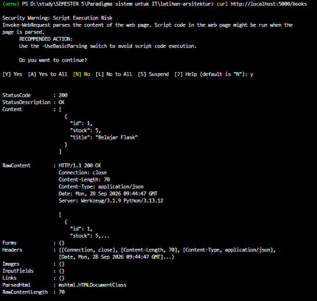

atau

```powershell
Invoke-RestMethod -Uri http://localhost:5000/books
```

**Buat pesanan**

```powershell
curl.exe -X POST -H "Content-Type: application/json" -d '{\"book_id\": 1}' http://localhost:5000/orders
```
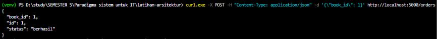

atau

```powershell
Invoke-RestMethod -Uri http://localhost:5000/orders -Method POST -ContentType "application/json" -Body '{"book_id": 1}'
```

### Langkah 4.5: Hasil yang diharapkan

| Uji | Hasil |
|---|---|
| Cek buku (awal) | Stok buku = 5 |
| Buat pesanan pertama | `{"id":1,"book_id":1,"status":"berhasil"}` dengan status 201 |
| Cek buku lagi | Stok berkurang menjadi 4 |
| Pesan ke-6 kali (stok 0) | `{"error":"Buku tidak ditemukan atau stok habis"}` status 400 |
| Pesan `book_id` 99 | Error yang sama, status 400 |

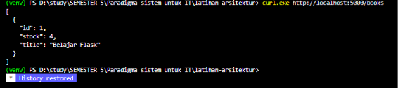

### Langkah 4.6: Kesimpulan bagian 1

Semua fitur berada dalam satu proses dan berbagi data yang sama. Stok berkurang otomatis karena fitur pesanan langsung mengubah variabel `books`.

---

## 5. Bagian 2: Membangun Aplikasi Microservices

Sistem dipecah menjadi dua layanan terpisah. Karena terpisah, Order Service **tidak bisa lagi membaca variabel `books` secara langsung**. Ia harus "menelepon" Book Service lewat HTTP request.

```
   Klien
     |
     |  POST /orders
     v
+----------------+   GET /books/{id}   +----------------+
| Order Service  | ------------------> |  Book Service  |
|   port 5002    | <------------------ |   port 5001    |
|  (data orders) |    JSON respons     |  (data books)  |
+----------------+                     +----------------+
```

### Langkah 5.1: Buat `book_service.py` (port 5001)

```python
from flask import Flask, jsonify

app = Flask(__name__)

# Database khusus Book Service
books = [{"id": 1, "title": "Belajar Flask", "stock": 5}]

@app.route('/books', methods=['GET'])
def get_books():
    return jsonify(books)

@app.route('/books/<int:book_id>', methods=['GET'])
def get_book(book_id):
    for b in books:
        if b['id'] == book_id:
            return jsonify(b)
    return jsonify({"error": "Not found"}), 404

if __name__ == '__main__':
    # Book service berjalan di port 5001
    app.run(port=5001, debug=True)
```
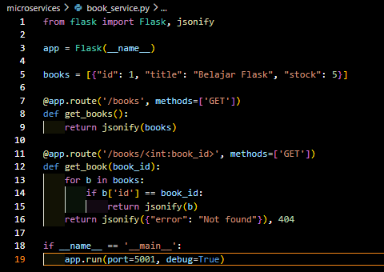

**Penjelasan:**

- `books` adalah data milik Book Service saja.
- `/books` menampilkan semua buku.
- `/books/<int:book_id>` menampilkan satu buku. Endpoint ini **baru** dan diperlukan agar layanan lain bisa menanyakan data satu buku lewat HTTP.
- Jika buku tidak ada, dikembalikan status `404`.

### Langkah 5.2: Buat `order_service.py` (port 5002)

```python
from flask import Flask, jsonify, request
import requests

app = Flask(__name__)
orders = []
BOOK_SERVICE_URL = "http://localhost:5001"  # Alamat Book Service

@app.route('/orders', methods=['POST'])
def create_order():
    data = request.get_json()
    book_id = data.get('book_id')

    # Komunikasi antar service: tanya Book Service apakah buku ada
    try:
        response = requests.get(f"{BOOK_SERVICE_URL}/books/{book_id}")
        if response.status_code == 200:
            book_data = response.json()
            if book_data['stock'] > 0:
                order = {"id": len(orders)+1, "book_id": book_id, "status": "berhasil"}
                orders.append(order)
                return jsonify(order), 201

        return jsonify({"error": "Buku tidak tersedia"}), 400
    except requests.exceptions.ConnectionError:
        return jsonify({"error": "Book Service sedang down!"}), 500

if __name__ == '__main__':
    # Order service berjalan di port 5002
    app.run(port=5002, debug=True)
```
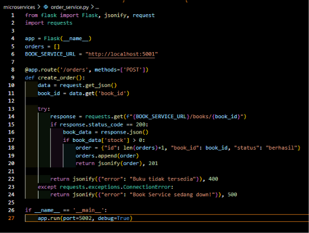

**Penjelasan:**

| Bagian | Penjelasan |
|---|---|
| `orders = []` | Data pesanan milik Order Service saja. |
| `BOOK_SERVICE_URL` | Alamat Book Service. Pada produksi biasanya berasal dari konfigurasi atau service discovery. |
| `requests.get(...)` | "Menelepon" Book Service. Ini pengganti akses variabel langsung di monolith. |
| `status_code == 200` | Memastikan Book Service menemukan bukunya. |
| `book_data['stock'] > 0` | Order Service memeriksa stok dari data yang dikirim Book Service. |
| `try/except ConnectionError` | Menangani kasus Book Service mati sehingga Order Service tetap hidup dan memberi pesan yang rapi. |

### Langkah 5.3: Jalankan ketiga terminal

Aktifkan `venv` di setiap terminal.

```powershell
# Terminal 1
python book_service.py

# Terminal 2
python order_service.py
```
#### Terminal 1 book_service.py
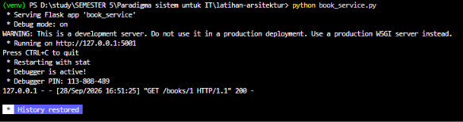

#### Terminal 2 order_service.py
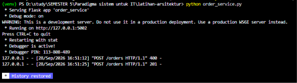


### Langkah 5.4: Uji coba

Terminal 3, uji Book Service secara mandiri:

```powershell
curl.exe http://localhost:5001/books/1
```


Buat pesanan lewat Order Service (port **5002**):

```powershell
curl.exe -X POST -H "Content-Type: application/json" -d '{\"book_id\": 1}' http://localhost:5002/orders
```


atau

```powershell
Invoke-RestMethod -Uri http://localhost:5002/orders -Method POST -ContentType "application/json" -Body '{"book_id": 1}'
```

**Hasil yang diharapkan:** `{"id":1,"book_id":1,"status":"berhasil"}` dengan status 201.

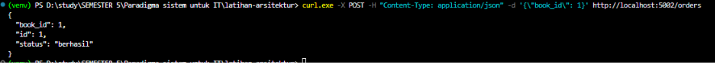

---

## 6. Eksperimen Fault Isolation

### Langkah 6.1: Matikan Book Service

Di Terminal 1, tekan `Ctrl+C` sehingga `book_service.py` berhenti.

### Langkah 6.2: Kirim ulang pesanan ke Order Service

```powershell
Invoke-RestMethod -Uri http://localhost:5002/orders -Method POST -ContentType "application/json" -Body '{"book_id": 1}'
```

### Langkah 6.3: Amati hasil

Order Service **tetap hidup** dan merespons `{"error": "Book Service sedang down!"}` dengan status 500. Kegagalan Book Service tidak menjatuhkan Order Service. Inilah yang disebut **Fault Isolation**.
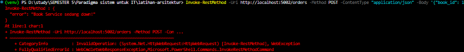

> Catatan: pada PowerShell, `Invoke-RestMethod` menampilkan error saat status 500. Untuk melihat isi pesannya, gunakan `curl.exe` (lihat bagian Troubleshooting).

### Langkah 6.4: Bandingkan dengan monolith

Pada monolith hanya ada satu proses. Jika bagian mana pun mengalami crash fatal, seluruh aplikasi (buku dan pesanan) ikut berhenti.

---

## 7. Temuan Analisis: Stok Tidak Berkurang

Ada perbedaan perilaku yang penting antara kedua versi:

| | Monolith | Microservices (kode awal) |
|---|---|---|
| Stok setelah pesanan | **Berkurang** | **Tidak berkurang** |
| Penyebab | Fitur pesanan langsung mengubah `books` | Order Service hanya *membaca* stok, tidak pernah memperbaruinya |

Artinya, pada kode awal microservices, pesanan bisa dibuat berulang kali tanpa stok habis. Ini juga menjadi pelajaran bahwa menjaga **konsistensi data antar layanan** jauh lebih rumit karena tidak ada transaksi bersama.

### Perbaikan

**Tambahkan endpoint pengurang stok di `book_service.py`:**

```python
@app.route('/books/<int:book_id>/reduce', methods=['PUT'])
def reduce_stock(book_id):
    for b in books:
        if b['id'] == book_id and b['stock'] > 0:
            b['stock'] -= 1
            return jsonify(b)
    return jsonify({"error": "Stok habis atau buku tidak ada"}), 400
```

**Ubah `create_order()` di `order_service.py`:**

```python
@app.route('/orders', methods=['POST'])
def create_order():
    data = request.get_json()
    book_id = data.get('book_id')

    try:
        response = requests.put(f"{BOOK_SERVICE_URL}/books/{book_id}/reduce", timeout=3)
        if response.status_code == 200:
            order = {"id": len(orders)+1, "book_id": book_id, "status": "berhasil"}
            orders.append(order)
            return jsonify(order), 201

        return jsonify({"error": "Buku tidak tersedia"}), 400
    except requests.exceptions.Timeout:
        return jsonify({"error": "Book Service terlalu lama merespons"}), 504
    except requests.exceptions.ConnectionError:
        return jsonify({"error": "Book Service sedang down!"}), 500
```

Perbaikan ini juga menambahkan `timeout=3` agar Order Service tidak menunggu tanpa batas.

**Verifikasi:** buat beberapa pesanan lalu cek `curl.exe http://localhost:5001/books`. Stok harus berkurang. Setelah 5 pesanan, pesanan berikutnya harus ditolak.

### Masalah konsistensi yang masih tersisa

Jika stok sudah dikurangi tetapi pembuatan order gagal (misalnya Order Service crash), data menjadi tidak konsisten. Di industri hal ini ditangani dengan pola seperti **Saga pattern** atau *compensating transaction*.

---

## 8. Perbandingan Monolith vs Microservices

| Aspek | Monolith | Microservices |
|---|---|---|
| Codebase | 1 | Banyak (1 per layanan) |
| Proses / port | 1 (5000) | Banyak (5001, 5002) |
| Komunikasi antar fitur | Panggilan fungsi/variabel langsung | HTTP request (jaringan) |
| Data | Dipakai bersama | Milik masing-masing layanan |
| Kecepatan komunikasi | Sangat cepat | Ada latensi jaringan |
| Fault isolation | Tidak ada, satu crash bisa mematikan semua | Ada, layanan lain tetap hidup |
| Scaling | Seluruh aplikasi digandakan | Per layanan |
| Deployment | Sederhana (1 unit) | Rumit (banyak unit) |
| Konsistensi data | Mudah | Sulit |
| Debugging | Mudah | Lebih sulit (lintas layanan) |

### . Kelebihan dan kekurangan

| | Kelebihan | Kekurangan |
|---|---|---|
| **Monolith** | Sederhana, mudah dikembangkan dan di-debug, cepat, satu deployment | Satu bug bisa menjatuhkan semuanya, scaling boros, makin sulit dirawat saat membesar |
| **Microservices** | Fault isolation, scaling per layanan, tim bisa bekerja independen, bebas memilih teknologi | Kompleks, latensi jaringan, konsistensi data sulit, butuh monitoring dan deployment lebih rumit |

### b.  Kapan memilih yang mana?

- **Monolith:** aplikasi kecil, tim kecil, tahap awal produk, kebutuhan cepat rilis.
- **Microservices:** aplikasi besar, banyak tim, beban tiap fitur sangat berbeda, dan perlu deployment independen.

---

## 9. Jawaban Bahan Diskusi

### Pertanyaan 1
*Di kode Monolith, jika fitur Pesanan mengalami crash/bug fatal, apa yang terjadi pada fitur Buku? Bandingkan dengan Microservices.*

- **Monolith:** fitur Buku ikut mati karena berada dalam satu proses. Ini disebut *single point of failure*.
- **Microservices:** Book Service tetap berjalan. Hanya fitur pesanan yang tidak tersedia.

### Pertanyaan 2
*Pengecekan stok di microservices lebih lambat karena HTTP request. Adakah solusi di industri nyata?*

Solusi yang umum dipakai:

- **Caching** (Redis, Memcached) agar data yang sering diminta tidak diambil berulang.
- **Asynchronous messaging** (RabbitMQ, Kafka) untuk proses yang tidak perlu respons instan.
- **API Gateway** dan **load balancer** untuk mengatur lalu lintas.
- **Protokol lebih ringan** seperti gRPC dibanding REST/JSON.
- Menempatkan layanan pada **jaringan/region yang sama** untuk menekan latensi.
- **Timeout dan circuit breaker** agar layanan yang lambat tidak menahan layanan lain.

### Pertanyaan 3
*Traffic pencarian buku melonjak, traffic pesanan biasa saja. Layanan mana (dan port mana) yang di-scale up?*

**Book Service (port 5001)**, karena beban ada pada pencarian buku. Order Service (port 5002) tidak perlu ditambah. Ini contoh *independent scaling*. Pada monolith, seluruh aplikasi harus digandakan, termasuk fitur pesanan yang sebenarnya sepi.

---

## 10. Troubleshooting

### Error `Cannot bind parameter 'Headers'` di PowerShell

```
Invoke-WebRequest : Cannot bind parameter 'Headers'. Cannot convert the "Content-Type: application/json" value ...
```

**Penyebab:** di PowerShell, `curl` adalah alias untuk `Invoke-WebRequest`, bukan curl asli, sehingga opsi `-H` ditafsirkan sebagai parameter `Headers` yang mengharuskan format dictionary.

**Solusi:**

1. Pakai `curl.exe` dan escape tanda kutip JSON:
   ```powershell
   curl.exe -X POST -H "Content-Type: application/json" -d '{\"book_id\": 1}' http://localhost:5002/orders
   ```
2. Pakai `Invoke-RestMethod`:
   ```powershell
   Invoke-RestMethod -Uri http://localhost:5002/orders -Method POST -ContentType "application/json" -Body '{"book_id": 1}'
   ```
3. Pakai Postman.


### Masalah lain

| Masalah | Kemungkinan penyebab | Solusi |
|---|---|---|
| `Address already in use` | Port sudah dipakai proses lain | Tutup proses lama atau ganti port |
| `Book Service sedang down!` padahal aktif | Book Service belum dijalankan atau port salah | Pastikan `book_service.py` berjalan di port 5001 |
| `ModuleNotFoundError: flask` | `venv` belum aktif atau library belum terinstal | Aktifkan `venv`, lalu `pip install Flask requests` |
| Data hilang setelah restart | Database masih in-memory | Perilaku normal pada latihan ini |
| Ukur waktu respons di PowerShell | Sintaks `-o /dev/null` tidak berlaku | Pakai `curl.exe -w "%{time_total}\n" -o NUL -s <url>` atau `Measure-Command { Invoke-RestMethod ... }` |

---

## 11. Kesimpulan

1. **Monolith** sederhana dan cepat karena seluruh fitur berbagi memori yang sama, tetapi memiliki *single point of failure* dan scaling yang boros.
2. **Microservices** memberikan *fault isolation* dan *independent scaling*, tetapi menambah kompleksitas berupa latensi jaringan, konsistensi data, dan operasional.
3. Perpindahan dari monolith ke microservices mengubah cara fitur berkomunikasi, dari pemanggilan variabel langsung menjadi HTTP request. Hal ini terbukti dari kebutuhan endpoint baru `/books/<id>` dan dari bug stok yang tidak berkurang pada kode awal microservices.
4. Tidak ada arsitektur yang selalu terbaik. Pilihan bergantung pada skala aplikasi, ukuran tim, dan kebutuhan bisnis.

---

## 12. Latihan Pengembangan

1. Tambahkan endpoint `GET /orders` di Order Service untuk melihat semua pesanan.
2. Tambahkan `timeout=3` pada `requests.get(...)` dan tangani `requests.exceptions.Timeout`.
3. Ukur dan bandingkan waktu respons monolith vs microservices, lalu catat hasilnya:

   | Percobaan | Monolith (detik) | Microservices (detik) |
   |---|---|---|
   | 1 | | |
   | 2 | | |
   | 3 | | |
   | Rata-rata | | |

4. Tambahkan **Payment Service** (port 5003) yang dipanggil setelah order dibuat.
5. Pindahkan data ke database sungguhan (SQLite atau MySQL), lalu pikirkan apakah tiap layanan sebaiknya punya database sendiri.

---

## Referensi

- Dokumentasi Flask: https://flask.palletsprojects.com
- Dokumentasi Requests: https://requests.readthedocs.io
- Modul praktikum "Hands-on: Arsitektur Monolith vs Microservices dengan Flask Python"
